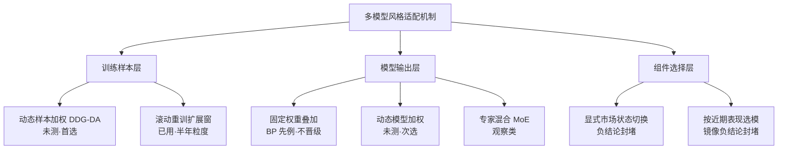

# 多模型风格适配调研：可行域与推荐路线

> **状态（2026-10-17）**：调研报告，未预注册、未开实验、零代码改动。
> 依据三源：master 负结论登记表（[experiment-playbook](experiment-playbook.md)
> §三）、alpha360-mining 分支（worktree，HEAD a12c08f，未并回）的
> alpha360 v2 现状、外部文献与 qlib 生态。目的：回答"风格切换时及时
> 反应、用多个模型做风格化匹配与收益提升"的可行方案空间。

## 结论速览

1. **现状澄清**：现行打分层并非静态单点训练——已带八段滚动前推
   （walk-forward，逐段只用截至重估时点的数据重估）与扩展训练窗；
   "单一 model"的准确含义是**单一模型族（LightGBM 浅树）加均匀样本
   权重**。模型轴已在同一特征与标签下对比四个模型（8 叶浅树、官方
   超参树、岭回归、反向传播网络诊断臂），能力高度接近：浅树与官方
   超参树的收益配对差仅 0.58 个百分点，未达 2 个百分点切换线。
2. **固定权重叠加先例为负**：BP（反向传播网络）与 LightGBM 按
   25%/50%/75%/90% 权重叠加，0 个基点口径最佳 +77.45%，未超过对应
   LightGBM 基准 +78.70%，不晋级。换更强模型或异构固定叠加，在当前
   特征集上不构成收益杠杆——瓶颈在特征信息量与标签可预测性，不在
   模型容量。
3. **两条切换机制路线已被负结论封堵**：显式市场状态识别→切换
   （四判据失败收口，2026-10-12）；按近期表现选组件（60 日质量选锚
   0/5 相位，2026-10-03）。多模型方案若采用"识别状态再切换"或
   "滚动追踪（trailing，用近期表现外推）择优"机制，直接撞登记表。
4. **未测且对症的机制类是训练分布适配**：DDG-DA（Data Distribution
   Generation——数据分布生成，按可预测的概念漂移模式预测下一段数据
   分布、对历史样本重加权后训练）在 qlib 官方 contrib 有实现
   （`qlib/contrib/rolling/ddgda.py`）。它与已失败机制不同轴：作用在
   训练样本层，不做组件级硬切换、不用近期表现外推。
5. **收益兑现瓶颈在执行侧**：稳定打分层毛信号 0 个基点 +76.08%、
   10 个基点 −71.37%（2023-01-03 至 2026-10-12、5 相位中位、样本内
   上界口径）——模型层任何增益在日频执行下不可兑现。降频调仓或
   打分层嫁接生产栈（v2 收口登记的剩余杠杆，待用户裁决）是多模型
   实验的前置或并行项。
6. **环境前置**：qlib360 环境依赖 pyqlib 已漂移（0.1.dev2068，非冻结
   版本 0.9.7），版本守卫红，修复前不可新鲜产出。

## 一、需求定义与现状

### 1.1 需求拆解

用户需求两个：① 市场风格切换时及时反应；② 用多个模型做风格化
匹配并提升收益。"风格"在本项目语境指市场风格的相对轮转（如大小盘、
高波低波、板块间的相对强弱切换），与已收口的"市场状态识别"（统计
分段意义上的 regime）区分：前者关注相对表现的领先-落后关系，后者
关注绝对波动结构的状态划分。

### 1.2 现状（alpha360-mining 分支 §十冻结组合）

- 特征：相对口径四族 + SYN（共振同步率）+ BRD（市场宽度）共 29 条，
  主窗 W=5；
- 标签：`label_oc1`（T+1 开盘至当日收盘收益），截面秩归一；
- 模型：LightGBM 8 叶浅树，单一模型族，均匀样本权重；
- 训练结构：扩展训练窗 + 八段半年滚动前推测试（首段 2023 年上半年）；
- 执行形态：TopkDropout（topk=5、n_drop=3）日频；
- 判定：打分层相对判据通过（相对 10 日绝对动量 +14.52 个百分点，
  单边 10 个基点、5 相位中位），日频执行系关闭。

### 1.3 风格适配在本栈的既有占位（L1 检查）

快慢功能挤占定律（playbook L1，七次证据）要求任何新组件先回答
"栈里谁已经在做这件事"：

| 既有组件 | 已承担的功能 | 与"风格适配"的关系 |
|---|---|---|
| 三锚动选层 | 按 leader（领先指数）动量在深证成指/国证2000/科创50 中动选 | **本身已是风格跟随机制**（跟谁） |
| 打分层（本次调研对象） | 在锚内选标的（买什么） | 与锚层功能正交 |
| 3 日动量闸门 + 领先半衰期 | 风险状态标记（何时不进） | 危险期识别的既有占位（regime 收口判据 5 的 86.8% 重叠即证据） |

因此"风格切换及时反应"若落在模型层（打分层的训练适配），与锚层
正交、不撞 L1；若落在组件层（按风格切换锚/闸门），则同时撞 L1 与
登记表两堵墙。

## 二、方法空间盘点

### 2.1 异构静态叠加（固定权重组合 / 元模型再组合）——不支持

机制：多个模型分别训练，预测按固定权重组合或再训练一层元模型。
项目内先例即 §10.8 BP 叠加诊断：同日截面秩归一后 LightGBM 权重
25%~90% 网格，两族基准（浅树 +76.08%、官方模型 +78.70%，0 个基点）
均未被叠加超过。结合模型轴四模型能力接近的事实，叠加的多样性红利
接近零——各模型在相同特征上学到的截面排序高度相关。外部文献
（如 Gu-Kelly-Xiu 2020 的多模型平均）报告的集成增益以模型个体足够
异质且各自有效为前提，本项目当前不满足该前提。

### 2.2 滚动重训扩展窗——已在用，不构成新增杠杆

八段半年滚动前推 + 扩展训练窗已冻结在 §十组合中。它的风格适配
粒度等于重估周期（半年），且训练窗网格已测过（固定半年窗全面劣于
扩展窗）。此机制是"多模型"的容器（每段可容纳不同模型/权重），但
单独不解决"及时反应"。

### 2.3 动态样本加权（DDG-DA）——未测，首选实验方向

机制：概念漂移（concept drift，输入与目标的联合分布随时间变化）
在金融序列上有可预测的漂移模式；DDG-DA 用一个元模型从"各历史段的
分布两两差异"学习漂移规律，预测下一段的数据分布，据此给历史训练
样本生成权重（与下一段分布相近的旧样本权重大），再在重加权样本上
训练基模型。qlib 官方实现位于 `qlib/contrib/rolling/ddgda.py`，
论文（KDD 2022，数据挖掘领域会议）在沪深300指数（CSI300）滚动重训
基准上报告 IC（信息系数，预测值与实现的截面相关；Rank IC 为其秩
版本）改善。

与已失败机制的本质差异：

- 与固定权重叠加（2.1）不同轴——它改变每个模型"学什么"，而非
  改变多个模型"怎么合"；
- 与按近期表现选模（2.6）不同机制——它从漂移模式预测未来分布，
  不用"近期谁表现好"外推；
- 与显式市场状态切换（2.5）不同粒度——输出连续样本权重，不产生
  硬状态标签与组件切换。

风险与成本：元模型自身引入超参（嵌入维度、漂移预测损失），在
935 标的×约 1,100 交易日的样本上需要防元模型过拟合；实现须适配
本项目的 ParquetProvider 链路与八段滚动骨架。

### 2.4 动态模型加权（在线误差加权）——未测，次选

机制：维护多个异构模型，按各模型近期预测误差（如滚动 Rank IC）
连续调整组合权重，日级反应粒度。与固定权重叠加的区别是权重随时间
变。风险：① 权重更新窗口本身是超参，易过拟合近期；② 若各模型
能力接近（§10.6 事实），动态权重的调变空间小；③ 权重频繁摆动
可能复现 HMM 日级切换 55.5% 一致率的噪声问题。作为 2.3 的对照臂
而非独立主线。

### 2.5 显式市场状态识别→模型/仓位切换——负结论封堵

市场状态识别（regime detection）四判据失败已于 2026-10-12 收口（确认率 4.1%、事件
对齐 2/5、亏损覆盖 13.3%、天级一致率 55.5%）。收口登记的重开条件：
用户解除 5 日特征约束或换特征族、换方法（如带持续性约束的 sticky
HMM）、或独立新样本，并重新预注册。"先识别状态再切模型"属于此
封堵域，除非满足重开条件。

### 2.6 按近期表现选模型——镜像负结论封堵

60 日质量选锚（按单锚概念策略近期表现动选锚）在 2022-06-01 相位族
至 2026-09-18、单边 10 个基点、5 相位配对口径下 0/5 相位胜出。机制
上"按 trailing（滚动追踪）表现选模型"与其同构，仅选择对象从锚换成
模型。若无新的机制论证，预期同命。

### 2.7 专家混合（MoE，mixture of experts）/门控网络——观察类

机制：门控（gating，按输入特征输出各专家权重）网络与多个专家模型
端到端训练，隐式学习"什么市况用什么模型"。风险：① 端到端门控的
自由度在本样本量（八段滚动、935 标的）下过拟合风险高；② 语义上是
把市场状态学习内嵌进网络，与 2.5 的区别仅在隐式/显式，而项目证据
（四判据失败 + 组合稀释三次证）对"复杂结构在该域兑现"整体不利。
列入观察，不开主线。

## 三、与登记表对照

| 本调研的判决 | 依据（登记表条目 / 分支证据） |
|---|---|
| 固定权重叠加不晋级 | alpha360-mining §10.8（a12c08f，stability_bp_ensemble.csv） |
| 模型容量不是瓶颈 | alpha360-mining §10.6：四模型秩相关 +0.0205/+0.0167/+0.0067，配对差 ≤0.58pp |
| 显式状态切换封堵 | playbook §三 regime detection 条（2026-10-12 收口） |
| 按近期表现择优封堵 | playbook §三 anchor-selection 条（2026-10-03） |
| 日频执行不可兑现 | §10.6 执行判定：0/10/30 个基点 = +76.08%/−71.37%/−99.25% |
| 学习化替换分钟重排两连败 | playbook §三 X3 与 A158-V1 条（重开条件=换目标/加滚动前推；本调研对象已是滚动前推结构，不撞此条） |

## 四、推荐路线与顺序

**P0（前置裁决，用户已有点名待决）：执行侧杠杆先行或并行。**
降频调仓或打分层嫁接现有生产栈（V4.4 三锚开盘栈）决定模型层增益
能否兑现——没有可执行形态，任何多模型改进只停留在打分层相对判据。
建议与 P1 并行推进：P1 不依赖 P0 的裁决结果，两者在预注册中作为
独立实验立项。

**P1（首选实验）：DDG-DA 式动态样本加权，单轴对照。**
在 §十冻结组合（特征、标签、浅树、八段滚动、TopkDropout 全部
冻结）上只替换一个轴：均匀样本权重 → DDG-DA 预测的样本权重。
对照臂即现行 §十组合本身。这一设计同时满足：单轮单改动（playbook
§一.3）、不撞任何登记表条目（新机制类）、直接检验"训练分布适配
能否带来风格切换的提前量"。

**P2（条件启动）：动态模型加权对照臂。**
仅当 P1 方向为正（过完整判据）后，再测"样本加权 + 模型动态权重"
的组合，分离两种适配的贡献。若 P1 负向，P2 大概率同样负向（模型
能力接近的事实未变），按登记表收口。

**封禁区**：显式市场状态切换、按近期表现选模、等权宽基锚、池扩张
（各自见登记表）。**观察区**：专家混合/门控（2.7），无独立立项计划。

## 五、若开 P1 实验的预注册要点（草案，开跑前须过 playbook §五）

1. 假设一句话：概念漂移可预测 ⇒ 按预测分布重加权训练样本，能让
   浅树在风格切换段（八段中后段）的截面排序提前适配 ⇒ 收益配对差
   改善。须写明与锚动选层功能正交（L1 检查答案）。
2. 判据（沿用 §一协议）：收益配对差中位 Δ≥+2 个百分点、≥4/5 相位、
   回撤不恶化超 1 个百分点、HARMFUL 界 −2 个百分点；滚动八段中
   后四段（2024H2 起）单独报告以防"全靠前段"。
3. 边缘探针（L2 孤峰防线）：DDG-DA 元模型超参（嵌入维度、段特征
   窗）至少各设低于/高于中心档一档；相邻档全负即孤峰处理。
4. 单轴声明：对照=§十冻结组合逐字复现；DDG-DA 引入的所有超参在
   开跑前冻结，禁止跑后调参翻案（regime 收口教训）。
5. 信号质量双口径：除账户判据外，报告滚动测试段（test 段）Rank IC
   与逐日秩相关的分段符号（八段中正段数），与 §10.6 可比。
6. 数据边界：退役码自检（`config.assert_no_retired`）；样本内上界
   措辞；概念指数不可直接交易、成本为统一压力假设、幸存者偏差
   标注齐全。
7. 环境前置：qlib360 环境恢复 pyqlib 0.9.7（版本守卫绿）后方可
   开跑；DDG-DA 组件按本项目 ParquetProvider 链路适配，适配层
   变更单独冒烟。

## 六、边界与措辞

- 本报告为调研，所有项目内数字均为样本内上界口径，不构成策略
  效果承诺；alpha360 v2 的数字来自未并回 master 的 alpha360-mining
  分支（a12c08f），并回时以分支收口文档为准。
- BP 诊断臂为受限诊断（60 轮上限收敛警告、非穷举网络结构），
  "叠加无增益"的结论边界是"该受限 BP 与固定权重网格"，不外推为
  一切神经网络叠加无效。
- 概念指数不可直接交易；成本为统一压力假设；概念目录存在幸存者
  偏差（playbook L3 措辞纪律）。

## 七、参考

外部：

- DDG-DA 论文：[Data Distribution Generation for Predictable Concept Drift（arXiv 2201.04038，KDD 2022）](https://arxiv.org/html/2201.04038v2)；qlib 实现 `qlib/contrib/rolling/ddgda.py`（[microsoft/qlib](https://github.com/microsoft/qlib)）。
- 市场状态与集成结合的近期文献（该类显式状态方法在本项目属封堵域，仅作机制对照）：[multi-model ensemble-HMM voting framework（Gupta 2025）](https://www.aimspress.com/article/doi/10.3934/DSFE.2025019)、[Two Sigma: A Machine Learning Approach to Regime Modeling](https://www.twosigma.com/articles/a-machine-learning-approach-to-regime-modeling)。

项目内（负结论与现状证据）：

- [experiment-playbook.md](experiment-playbook.md) §二 L1/L2/L3、§三登记表（regime detection、anchor-selection、X3、A158-V1 各条）。
- [regime-detection-closeout.md](regime-detection-closeout.md)（四判据失败与重开条件）。
- alpha360-mining 分支：`docs/research/alpha360-v2-plan.md` §十（稳定组合与模型轴）、§10.8（BP 叠加诊断）；`outputs/alpha360/stability_report.md`、`stability_bp_ensemble.csv`。
